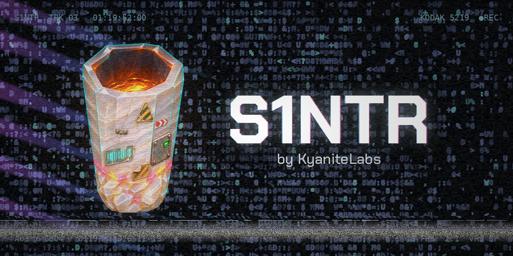

# S1NTR

S1NTR: a tool for coding art. It is a TypeScript studio and CLI that turns prompts into visual, audio, and motion pieces, then lets you preview them locally. It routes work to a configured language model and supports local models through OpenAI-compatible endpoints.

## Install

The npm package name is `s1ntr`; the CLI command is still `sinter`. Once the npm release ships:

```bash
npm install -g s1ntr
sinter --version
```

Until then, install it from a checkout of this repository:

```bash
pnpm install
pnpm build
pnpm link --global
sinter --version
```

S1NTR requires Node.js 20 or newer.

`pnpm install` runs install scripts: S1NTR's own `postinstall` (`scripts/packaging/postinstall.mjs`, which runs `npm run build` when `dist/` is missing) and those of its dependencies. To review them first, install with `pnpm install --ignore-scripts`, read the scripts, then run `pnpm rebuild`.

## Quick start

```bash
# Configure a provider (the default setup uses Anthropic).
sinter --configure

# Make a first piece. Generation uses your configured provider.
sinter --prompt "A quiet field of blue particles, moving like grass in wind"

# Start the local preview server and open its printed address.
sinter serve
```

S1NTR saves generated files under `~/.sinter/output` by default. Pass `--output ./my-art` to choose another folder. `sinter serve` starts the local preview server and loads the latest saved piece. The Studio GUI is available from a repository checkout with dependencies installed.

## Main commands

- `sinter --help` lists commands and common options.
- `sinter --version` prints the installed version.
- `sinter --prompt "..."` or `sinter "..."` generates a piece. A generation may use paid provider calls.
- `pnpm gui` (or `sinter studio`) opens the Studio GUI workbench from your checkout.
- `sinter serve [port]` starts the local preview server (default port `3456`).
- `sinter provider help` explains provider setup; `sinter provider list` lists configured provider types.
- `sinter list` lists saved sketches.

See the full [CLI reference](https://docs.s1ntr.com/cli) and [getting-started guide](https://docs.s1ntr.com/guide) for command syntax.

## Mediums

- S1NTR supports **15 creative domains**. Its mediums include p5.js sketch, three.js scene, shader, hydra feedback synth, SVG drawing, webpage, data visualization, kinetic type and CSS motion, ASCII art, concrete poetry, strudel live-coded music, Tone.js sound piece, Blender render, fluid light simulation and invented medium.
- **CreativeBoard critique** — 3-agent board (Minimalist / Expressionist / Technician) deliberates on output
- **Swarm generation** (`--use-swarm`) — 5 default runtime personas (Kai / Nova / Rex / Sam / Max).
  Five default personas (Kai, Nova, Rex, Sam, Max) generate in parallel and vote on best.

Prompt routing selects a medium automatically; use `--domain` to request one explicitly.

## Ready-to-show market path

Use this path when you want to try S1NTR as a product instead of asking an agent to babysit a proof run. It keeps the shared creative surface in scope: p5, SVG, shader, Three.js, Hydra, Strudel, Tone.js, ASCII, kinetic type and CSS motion, concrete poetry, webpage, data visualization, Blender, fluid light simulation, and invented medium.

```bash
# 1. Install and build
pnpm install
pnpm build

# 2. Configure a provider (or run sinter --configure)
export SINTER_LLM_PROVIDER=glm
export GLM_API_KEY=your-key

# 3. Generate from natural language
sinter "a luminous blue-green particle garden"

# 4. Launch Studio for chat, same-screen preview, revision, and optional details
pnpm gui

# 5. Studio smoke (same-screen preview path)
pnpm proof:studio-smoke

# 6. Refresh the live provider receipt used by the market gate
pnpm run proof:live-provider-smoke -- --provider=glm --timeout-ms=120000

# 7. Sweep every launch medium with the active live provider
pnpm proof:live-creative-domains -- --provider=glm --all --timeout-ms=120000 --out=.omx/proof/live-creative-domains

# 8. Ask the app for the plain answer
sinter market status
```

Expected current result: `sinter market status` prints the release-truth report as JSON and exits 0 only when `ownerReleaseReady` is true (otherwise 2). Strudel patterns are saved with an external playback link, Tone.js saves playable HTML.

## Local models

S1NTR can call local OpenAI-compatible servers such as LM Studio. For a local LFM3 model, start the model server, then set its endpoint and served model name:

```bash
sinter provider set-key lmstudio --base-url http://localhost:1234/v1 --model LFM3 --use
```

Replace `LFM3` with the model identifier exposed by your server. S1NTR handles LFM3's final answer for both streamed and non-streamed responses.

## Project `.env` files

When you run `sinter` in a folder with a `.env` file, S1NTR reads only API keys (`*_API_KEY`), model names (`*_MODEL`) and `SINTER_LOG_LEVEL` from it, and never replaces a value your shell already set. Anything else, such as a base URL, a browser path, `NODE_OPTIONS` or a sandbox switch, is ignored with a one-line warning, so a `.env` in a downloaded folder cannot redirect your key or change what runs. Export those settings in your shell instead, or run with `SINTER_TRUST_DOTENV=1` to load the whole file.

## Where to go next

- [Getting started](https://docs.s1ntr.com/guide): configure a provider, code your first piece, and open its preview.
- [CLI reference](https://docs.s1ntr.com/cli): commands and flags parsed by the current CLI.
- [Handbook](https://docs.s1ntr.com/): the full documentation.
- [Mediums](https://docs.s1ntr.com/mediums): every medium S1NTR codes in.
- [Changelog](CHANGELOG.md): release history.
